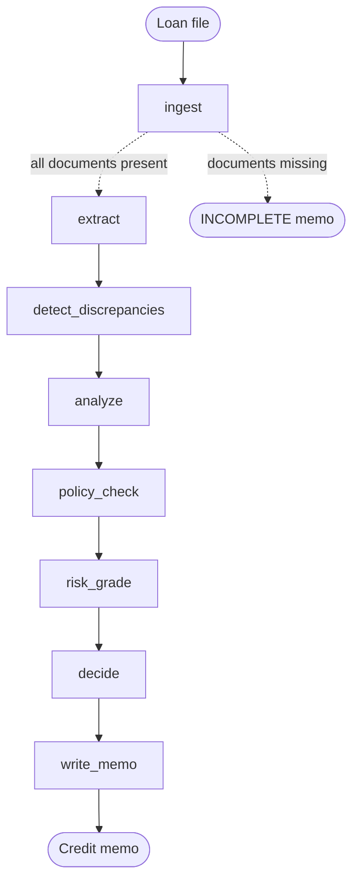

# CreditAgent

**An agentic credit underwriting pipeline built on LangGraph.** It reads a retail loan file (application, payslip or ITR, bank statement, bureau report), cross-checks the documents against each other, applies credit policy, grades the risk and writes a credit memo with a clear recommendation.

The point isn't to automate the credit decision away. It's to do the first 80% of an underwriter's work in seconds, and make every number in the output traceable to a source document.

[](https://github.com/aditi200990/credit-agent/actions/workflows/ci.yml)


> All data in this repo is synthetic. No real customers, lenders or bank systems are involved.

---

## Walkthrough

- **Interactive explainer:** [`docs/index.html`](docs/index.html). Pick a loan file and step through all eight nodes, with the real code and output at each step. Turn on GitHub Pages (Settings → Pages → deploy from `main` / `docs`) to get a live link.
- **2-minute video:** [`docs/creditagent-walkthrough.mp4`](docs/creditagent-walkthrough.mp4), with captions in [`.srt`](docs/creditagent-walkthrough.srt) and a [narration script](docs/narration-script.md).

## Why this exists

In retail lending, most of an underwriter's time goes on reconciliation rather than judgement: does the payslip match the bank credits? Does the bureau show every loan the customer is paying? Is the declared income real? Generic "chat with your PDF" tools don't help much, because they summarise documents one at a time.

CreditAgent treats underwriting as a **workflow across documents**. The most valuable output is often the discrepancy list, not the score.

## How it works



| Node | What it does |
|---|---|
| **ingest** | Loads the file and checks the right income proof is present for the employment type (payslip if salaried, ITR if self-employed). Short-circuits if anything is missing. |
| **extract** | Turns semi-structured documents into fields: income, employer, identity, bureau accounts, salary credits, recurring EMIs, bounces. |
| **detect_discrepancies** | Cross-checks every source against the others: name and PAN, employer vs salary payer, declared vs proven vs banked income, and EMIs in the bank statement that the bureau doesn't show. |
| **analyze** | Underwrites on the **lowest verified income** and the **higher of bureau or banked EMIs**, then computes proposed EMI, FOIR, loan-to-income and balance cover. |
| **policy_check** | Applies hard rules (score, DPD, write-offs, FOIR, minimum income) and soft rules (enquiries, bounces, balance cover). |
| **risk_grade** | Transparent points-based grade from A to E, so every point deducted can be explained. |
| **decide** | High-severity discrepancy → **REFER** (the data can't be trusted yet). Hard breach → **DECLINE**. Soft exception → **REFER**. Otherwise **APPROVE**. |
| **write_memo** | Produces a markdown credit memo. If an LLM is configured, it writes the analyst commentary, which then goes through a grounding guard. |

## The three sample cases

| Case | What's in the file | Outcome |
|---|---|---|
| `clean_salaried` | Consistent documents, score 782, FOIR 27.6% | ✅ **APPROVE**, grade A |
| `income_mismatch` | Payslip says ₹1,50,000 but salary actually arrives from a *different employer* at ₹92,000. The bank statement also shows an ₹18,000 EMI to a lender missing from the bureau report. | ⚠️ **REFER**, 3 high-severity flags |
| `high_risk_self_employed` | Documents are consistent, but score is 641, 60 DPD, 6 enquiries, 2 ACH bounces and FOIR 70.9% | ❌ **DECLINE** |

The second case is the interesting one. On the declared numbers it looks fine. Only reconciliation across documents shows the risk. Sample memos are in [`outputs/`](outputs/).

## Guardrail: no invented numbers

LLMs are good at writing commentary and bad at keeping figures straight. Before any LLM-written text reaches the memo, CreditAgent extracts every number from it and checks each one against the facts it was given. If a single figure can't be traced to source data, the commentary is discarded, the deterministic version is used, and the rejection is recorded in the memo.

This is tested with a fake model in [`tests/`](tests/test_credit_agent.py), so the guard is verified without any API key.

## Evaluation

```bash
python evals/run_evals.py
```

```
case                      expected  actual    ok  flags hit  false +  memo          grounded
clean_salaried            APPROVE   APPROVE   ✓   0/0        0        template      ✓
income_mismatch           REFER     REFER     ✓   3/3        0        template      ✓
high_risk_self_employed   DECLINE   DECLINE   ✓   0/0        0        template      ✓

Decision accuracy     3/3 (100%)
Discrepancy precision 100%   recall 100%
Memo grounding        3/3 memos with every figure traceable to source data
```

The harness measures what a credit team would care about: right decision, right red flags (precision and recall), and memos that don't contain invented figures. It exits non-zero on any regression and runs in CI on every push.

## Quick start

```bash
git clone https://github.com/aditi200990/credit-agent.git
cd credit-agent
pip install -r requirements.txt

python -m credit_agent --all              # run all sample cases, memos go to outputs/
python -m credit_agent data/applications/income_mismatch
pytest -q                                 # 11 tests
```

No API key is needed. Everything runs offline by default.

### Optional: LLM-written commentary

Any OpenAI-compatible endpoint works (OpenAI, Mistral, Groq, vLLM, or a local Ollama):

```bash
export CREDITAGENT_LLM_BASE_URL=http://localhost:11434/v1   # e.g. Ollama
export CREDITAGENT_LLM_MODEL=mistral
export CREDITAGENT_LLM_API_KEY=...                          # if your provider needs one
python -m credit_agent --all
```

## Project structure

```
credit_agent/
  graph.py       LangGraph workflow: nodes, edges, conditional branch
  state.py       typed state shared between nodes
  documents.py   loading and completeness checks
  extract.py     document → structured fields
  checks.py      cross-document discrepancy detection
  analysis.py    metrics, credit policy, risk grade, decision logic
  memo.py        memo builder and grounding guard
  llm.py         optional OpenAI-compatible client
data/applications/   three synthetic loan files
evals/               labelled expectations and eval harness
tests/               unit and end-to-end tests
outputs/             generated sample memos
docs/                interactive walkthrough, video, captions, narration script
```

## Design choices

- **Deterministic where it matters, LLM where it helps.** Policy, maths and the decision are code, so they're auditable and reproducible. The LLM only writes prose, and that prose is checked.
- **Conservative by construction.** Income is the lowest verified figure and obligations are the highest observed, which mirrors how a cautious credit officer reads a file.
- **Discrepancies outrank policy.** When the documents disagree, the right answer is "a human needs to look", not a score.
- **Explainable grading.** Points, not a black-box model, so every recommendation can be defended to a credit committee or an auditor.

## Roadmap

- [ ] LLM / document-AI extraction for scanned PDFs, using the same output schema
- [ ] Human-in-the-loop interrupt on REFER cases using LangGraph checkpoints
- [ ] RAGAS faithfulness scoring alongside the numeric grounding check
- [ ] Larger synthetic test set with generated edge cases
- [ ] Streamlit front end for analysts

## Author

Built by **Aditi Sharma**, Head of Analytics in Indian retail banking, working on credit risk, fraud and GenAI. [LinkedIn](https://linkedin.com/in/YOUR-LINKEDIN)

Released under the MIT License.
